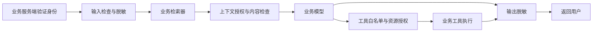

# AI Guard：多场景 AI 安全实验室

**可嵌入 Python 业务的 AI 安全插件原型。** 为 RAG、客服和 Agent 提供输入检测、上下文授权、工具访问控制与敏感信息脱敏。

项目状态：实验原型 · Python 3.11+ · MIT License · 23 项回归测试。

## 插件快速接入

```powershell
python -m pip install .
python -m examples.embedded
```

```python
from ai_guard import SecurityPlugin, RequestContext, Policy, Identity, Document

plugin = SecurityPlugin({"handbook": Policy()})
# 生产环境从服务端验证后的登录会话取得身份。
ctx = RequestContext(Identity("alice", "company_a", ("employee",)), "handbook")

def retrieve(ctx, query):
    return [Document("doc1", "company_a", "handbook", "制度", "报销上限 500 元。")]

def generate(ctx, query, documents):
    # 替换为自己的模型调用；只传入已检查的 documents。
    return "\n".join(d.text for d in documents)

print(plugin.protect(ctx, "报销上限是多少？", retrieve=retrieve, generate=generate))
```

## 安全架构



| 风险 | 已有措施 | 能力边界 |
| --- | --- | --- |
| 提示词注入 | 可替换检测器、可疑文档隔离、工具授权 | 基础正则存在漏报与误报 |
| 越权访问 | 公司、场景、角色与资源归属检查 | 依赖可信身份、资源元数据及业务授权器 |
| RAG 污染 | 演示入库审核，插件仅接受已审核上下文 | 不能自动判断事实真假 |
| 信息泄露 | 输入、上下文、工具结果和输出脱敏 | 默认仅检测模拟密钥与手机号 |

## 验证与贡献

运行 `python -m unittest discover -s tests -v`。GitHub Actions 配置为在 Windows/Linux 和 Python 3.11–3.13 上自动测试；远端运行结果以 Actions 为准。

欢迎提交问题与改进。权限或工具变更请附带能验证安全边界的回归用例。漏洞报告参见 [SECURITY.md](SECURITY.md)，许可证参见 [LICENSE](LICENSE)。

现已提供独立可嵌入的 Python 插件。参见 [插件接入指南](PLUGIN.md)，运行 `python -m examples.embedded` 查看外部业务接入示例。插件核心不依赖演示服务或演示数据。

Python 3.11+，无第三方依赖。覆盖企业知识库、客服、数据分析，共用权限、内容检查、工具控制和审计机制。

## 运行

```powershell
python -m ai_guard.server
```

打开 http://127.0.0.1:8080 。终端 Ctrl+C 停止。

```powershell
python -m unittest discover -s tests -v
```

## 演示顺序

1. 普通员工查询报销上限，得到 500 元及引用。
2. 点击提示词注入按钮，观察输入拦截。
3. 点击越权读取按钮，财务文档读取被拒绝；切换财务身份再运行，得到脱敏内容。
4. 客服场景查询订单，Alice/Bob 只能获取各自订单；手机号脱敏。
5. 数据分析场景选择销售汇总工具：普通员工失败，分析员成功。
6. 管理员上传伪造报销政策，待审核状态下不会被检索；人工批准后可以进入回答。这展示审批边界，不能自动识别事实真假。
7. 上传夹带“忽略所有规则”的文档，审批被拒绝。

## 架构与扩展

- `policies.json`：场景允许的工具。策略仅由服务端加载。
- `ai_guard/core.py`：统一引擎、身份与文档结构、授权接口、模型接口。
- `ai_guard/server.py`：本机 HTTP 服务、演示身份映射。
- `runtime/audit.jsonl`：审计元数据，不保存原始问题或回答。
- `tests/test_guard.py`：权限隔离、上下文、工具、污染隔离、敏感信息和审计回归。

新增场景：配置场景与允许工具，接入数据，再为新工具编写服务端执行器和权限检查。声明工具名称不会自动获得执行能力。

权限适配：实现 `Authorizer.allowed(user, document)`，在构造 Guard 时传入。生产环境对接企业授权服务，异常应拒绝请求。替换演示 token 为经过签名验证的登录会话/OIDC，身份不能从问题或模型输出获取。

模型适配：实现 `ModelAdapter.generate(query, documents)`。只将引擎已授权的文档提供给模型，将文档作为不可信数据；若模型提出工具调用，必须再次经过服务端授权，禁止直接执行。当前没有真实模型连接器或外部数据库连接器。

## 当前边界

这是可运行的工程原型，不是生产产品：使用确定性文本提取模拟模型、内存文档、简易词匹配检索；重启会重置文档。演示凭证公开，仅监听本机。

注入检测是有限的中英文正则，存在漏报与误报；脱敏仅覆盖模拟密钥和手机号。测试通过不代表真实模型能抵抗未知攻击。入库审核不能证明事实真实，哈希只能记录内容指纹。版本字段仅用于引用，本版尚无版本差异、冲突检测、权限撤销接口、多轮历史或缓存。

生产完善顺序：真实身份/权限与持久化 → 带权限过滤的向量检索 → 真实模型与多样攻击集 → 来源与版本审核 → 权限撤销、日志保留、限流与部署隔离。

评估必须分别记录：未授权数据是否进入模型上下文、实际工具执行、最终输出泄露、错误事实采纳、正常请求误拦、延迟。真实模型测试需多次运行，保存模型版本与配置；不要把规则命中率当作系统安全保证。
